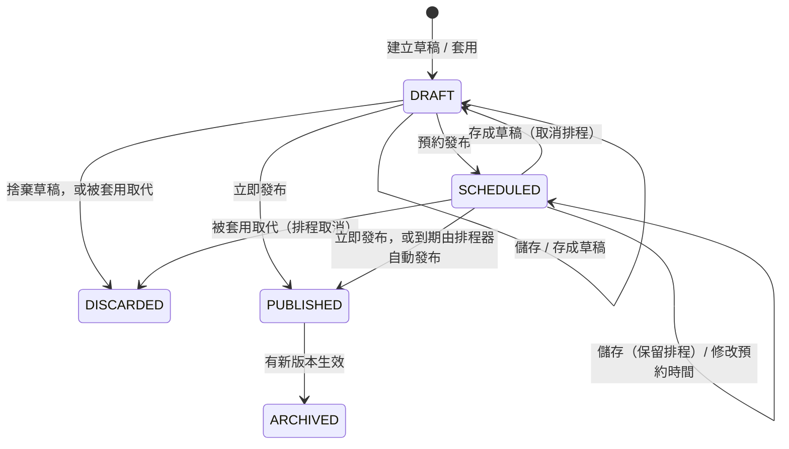

# 04 MongoDB Schema

> 版本：v0.9（POC）・2026-10-21

## 1. Collection 總覽

| Collection | 用途 | 資料量預估 | Sharding |
|---|---|---|---|
| `COLL_ICRM_AI_ASSISTANT_CONFIG` | System Prompt 與 System Instructions 的所有版本 | 數十到數百筆 | 不需要 |
| `COLL_ICRM_AI_ASSISTANT_AUDIT` | 稽核紀錄（提問、回答、工具呼叫） | 每次提問 1 筆，保留 180 天 | POC 不 shard；全行開放後很可能需要（見第 5 節，待確認） |

> collection 前綴採 SP 計畫指定的 `COLL_ICRM_`；index 名稱比照使用 `UK_ICRM_`、`IX_ICRM_`。
> 對話內容**不保存供使用者回看**（需求 3-1），所以沒有對話 collection；稽核 collection 只保存每次提問與最終回答，供稽核使用（需求 3-4）。

---

## 2. `COLL_ICRM_AI_ASSISTANT_CONFIG`

### 2.1 Document

每個版本是一份獨立的 document，不把版本歷程嵌在陣列裡。

| 欄位 | 型別 | 必填 | 說明 |
|---|---|---|---|
| `_id` | ObjectId | ✓ | |
| `configKey` | string | ✓ | `^(system\|instruction)\.[a-z0-9-]{1,50}$` |
| `configType` | string | ✓ | `SYSTEM_PROMPT`（只有一份 `system.main`）或 `SYSTEM_INSTRUCTION`（每份一個問題分類） |
| `name` | string | ✓ | 顯示名稱，1–50 字 |
| `content` | string | ✓ | Markdown 內容，最多 65,536 字元（API 另檢查 UTF-8 bytes） |
| `status` | string | ✓ | `DRAFT`（草稿）、`SCHEDULED`（已排程）、`PUBLISHED`（已發布）、`ARCHIVED`（已封存：曾上線、後被新版取代）、`DISCARDED`（已捨棄：未上線就被捨棄或被套用取代） |
| `version` | int | ✓ | 內部流水號，同一個 `configKey` 從 1 開始遞增；只用於 API 路徑、排序與唯一索引（需求 3-5），**畫面不顯示** |
| `basedOnVersion` | int \| null | | 套用歷史版本時記錄來源版本的流水號 |
| `changeNote` | string \| null | | 修改說明，最多 200 字 |
| `createdBy` | string | ✓ | |
| `createdAt` | date | ✓ | |
| `updatedBy` | string | ✓ | 最後一次變更這份版本的人：儲存、套用、預約、發布會更新；**封存不更新**（見 2.4） |
| `updatedAt` | date | ✓ | 最後一次變更的時間；已發布 / 已封存版本即為生效時間，畫面以它辨識版本 |
| `scheduledAt` | date \| null | | 預約發布時間。`SCHEDULED` 必填；退回草稿時清空；排程發布後保留，作為「原預約時間」紀錄 |
| `docVersion` | long | ✓ | Spring Data `@Version` 樂觀鎖，每次更新加 1 |

> 後台管理人員和 IT 管理人員都可以發布，不另設審核關卡；不另設 `publishedBy`、`publishedAt`，發布資訊記在 `updatedBy`、`updatedAt`，以版本歷程追溯每次變更。

> `version` 和 `docVersion` 用途不同：`version` 是 v1、v2、v3 這種業務版本；`docVersion` 是防止同一份 document 被同時修改的樂觀鎖。

範例：

```json
{
  "_id": { "$oid": "6713a1f0c2a4b5e6f7a8b9c0" },
  "configKey": "instruction.market-brief",
  "configType": "SYSTEM_INSTRUCTION",
  "name": "市場快訊",
  "content": "## 適用問題\n使用者詢問大盤、指數、個股行情或公司重大訊息……\n\n## 回答套版\n……\n\n## 範例問題\n- 今天大盤收盤如何？\n\n## 注意事項\n……",
  "status": "PUBLISHED",
  "version": 2,
  "basedOnVersion": null,
  "changeNote": "補充資料時間的說明",
  "createdBy": "it.admin",
  "createdAt": { "$date": "2026-10-19T02:00:00Z" },
  "updatedBy": "backoffice.admin",
  "updatedAt": { "$date": "2026-10-24T01:00:00Z" },
  "scheduledAt": { "$date": "2026-10-24T01:00:00Z" },
  "docVersion": 4
}
```

> 這個範例是 `backoffice.admin` 預約在台北時間 10/24 09:00 發布、由系統到期自動發布的版本：`updatedBy` 記預約的人，`updatedAt` 是實際生效時間。

### 2.2 Index

| 名稱 | 欄位 | 選項 | 用途 |
|---|---|---|---|
| `UK_ICRM_AI_CFG_1` | `{ configKey: 1, version: 1 }` | unique | 需求指定；同一個 key 的內部流水號不重複 |
| `UK_ICRM_AI_CFG_2` | `{ configKey: 1 }` | unique，partial：`{ status: "PUBLISHED" }` | 由資料庫保證同一個 key 只有一個已發布版本 |
| `UK_ICRM_AI_CFG_3` | `{ configKey: 1 }` | unique，partial：`{ status: "DRAFT" }` | 同時建立草稿時只有一份成功 |
| `IX_ICRM_AI_CFG_4` | `{ status: 1, configType: 1 }` | | 讀取所有已發布設定（組 prompt 時使用） |
| `IX_ICRM_AI_CFG_5` | `{ status: 1, scheduledAt: 1 }` | partial：`{ status: "SCHEDULED" }` | 排程器查詢到期的版本 |

> **一個 key 同時只有一份「編輯中版本」（`DRAFT` 或 `SCHEDULED`）**。`SCHEDULED` 只能由既有的 `DRAFT` 原地轉換而來，所以「建立草稿」時檢查兩種狀態都不存在，再加上 `UK_ICRM_AI_CFG_3` 擋住同時建立，就能保證這條規則。

### 2.3 JSON Schema Validation

```javascript
db.createCollection("COLL_ICRM_AI_ASSISTANT_CONFIG", {
  validationLevel: "strict",
  validationAction: "error",
  validator: {
    $jsonSchema: {
      bsonType: "object",
      required: ["configKey", "configType", "name", "content", "status", "version",
                 "createdBy", "createdAt", "updatedBy", "updatedAt", "docVersion"],
      properties: {
        configKey:      { bsonType: "string", pattern: "^(system|instruction)\\.[a-z0-9-]{1,50}$" },
        configType:     { enum: ["SYSTEM_PROMPT", "SYSTEM_INSTRUCTION"] },
        name:           { bsonType: "string", minLength: 1, maxLength: 50 },
        content:        { bsonType: "string", maxLength: 65536 },
        status:         { enum: ["DRAFT", "SCHEDULED", "PUBLISHED", "ARCHIVED", "DISCARDED"] },
        version:        { bsonType: "int", minimum: 1 },
        basedOnVersion: { bsonType: ["int", "null"], minimum: 1 },
        changeNote:     { bsonType: ["string", "null"], maxLength: 200 },
        createdBy:      { bsonType: "string" },
        createdAt:      { bsonType: "date" },
        updatedBy:      { bsonType: "string" },
        updatedAt:      { bsonType: "date" },
        scheduledAt:    { bsonType: ["date", "null"] },
        docVersion:     { bsonType: "long" }
      }
    },
    // SCHEDULED 必須有預約時間
    $or: [
      { status: { $ne: "SCHEDULED" } },
      { scheduledAt: { $type: "date" } }
    ]
  }
});
```

> validator 可以同時使用 `$jsonSchema` 和查詢運算子；上面的 `$or` 確保 `SCHEDULED` 一定有 `scheduledAt`。`ConfigService` 也會在寫入前檢查。

### 2.4 版本策略



- **已封存（`ARCHIVED`）**：曾經上線、後來被新版本取代。`updatedAt` 是它當初的生效時間。
- **已捨棄（`DISCARDED`）**：從未上線就被放棄，包括「捨棄草稿」與「被套用取代的草稿或排程」。內容完整保留，`updatedAt` / `updatedBy` 是捨棄的時間與操作者，原作者見 `createdBy`。
- **沒有任何操作會刪除 document**，所有內容（含未上線的）都留在版本歷程中。

套用歷史版本（`PUBLISHED`、`ARCHIVED` 或 `DISCARDED`）時，**一律新增一份 `DRAFT`**；若已有編輯中版本（`DRAFT` 或 `SCHEDULED`），在同一個交易中把它改成 `DISCARDED`。

| 操作 | 對象 | 行為 | `updatedBy` / `updatedAt` |
|---|---|---|---|
| 建立草稿 | — | 已有 `DRAFT` 或 `SCHEDULED` → 409。否則複製目前已發布版本的 `name`、`content`，新增 `version = 最大值 + 1`、`status = DRAFT` | 操作者 / 現在 |
| 儲存 | DRAFT | 更新內容，維持 `DRAFT` | 操作者 / 現在 |
| 儲存 | SCHEDULED | 更新內容，**保留排程**；先執行發布前驗證，不通過 → 422 | 操作者 / 現在（視為由此人重新確認排程） |
| 存成草稿 | DRAFT | 同「儲存」 | 操作者 / 現在 |
| 存成草稿 | SCHEDULED | 更新內容，`status = DRAFT`、清空 `scheduledAt`（取消排程） | 操作者 / 現在 |
| 立即發布 | DRAFT、SCHEDULED | 先驗證；在交易中把舊的 PUBLISHED 改成 ARCHIVED、編輯中版本改成 PUBLISHED | 新版：操作者 / 現在；**舊版：不改動** |
| 預約發布 | DRAFT、SCHEDULED | 先驗證；`status = SCHEDULED`、寫入 `scheduledAt`（已排程時即修改預約時間） | 操作者 / 現在 |
| 排程到期 | SCHEDULED | 排程器在交易中把舊的 PUBLISHED 改成 ARCHIVED、SCHEDULED 改成 PUBLISHED；`scheduledAt` 保留 | 新版：**維持預約者** / 實際生效時間；舊版：不改動 |
| 套用 | 來源：PUBLISHED、ARCHIVED、DISCARDED | 已有編輯中版本且未帶 `confirmOverwrite: true` → 409 `AI_CONFIG_OVERWRITE_PENDING`。否則在交易中：(1) 既有的編輯中版本改為 `DISCARDED`（`scheduledAt` 保留，作為「原預約時間」紀錄）；(2) 新增一份 `DRAFT`：`version = 最大值 + 1`，`name`、`content` 取自來源版本，`basedOnVersion = 來源版本`，`changeNote` 空。來源版本本身不變 | 新草稿：操作者 / 現在（`createdBy` 也是操作者）；被取代的版本：操作者 / 現在 |
| 捨棄草稿 | DRAFT | `status = DISCARDED`，內容保留，不刪除；`SCHEDULED` 需先存成草稿才能捨棄 | 操作者 / 現在 |

所有寫入都以 `docVersion` 做條件更新；不一致 → 409 `AI_CONFIG_CONFLICT`。

**為什麼封存時不改動舊版的 `updatedBy` / `updatedAt`**

- 畫面以 `updatedAt` 辨識版本（不顯示版本號），已發布或已封存版本的 `updatedAt` 必須固定是它當初生效的時間。
- 舊版只會在另一個版本生效時被封存，沒有單獨的封存操作。所以封存的時間與造成封存的人，就是下一個版本的 `updatedAt` 與 `updatedBy`，從版本歷程即可推得，不需要另外記錄。

**預約時間規則**

- 至少 1 分鐘後、最多 90 天內，否則 400 `AI_INPUT_INVALID`。
- API 以 ISO 8601 含時區傳遞，資料庫存 UTC，管理頁以台北時間顯示。

**排程器（`ScheduledPublishJob`）**

- 每 30 秒查詢 `status = SCHEDULED` 且 `scheduledAt <= 現在` 的版本，逐筆在交易中發布，最多延遲約 30 秒。
- 以條件更新（`status` 仍為 `SCHEDULED` 且 `docVersion` 相符）確保多台機器同時執行時只會發布一次；失敗的一方直接略過。
- 發布成功後清除 prompt 快取。
- 發布失敗（例如交易衝突）會在下一輪重試，並記 WARN log（只含 configKey、version、錯誤類型）。

**套用時已有編輯中版本**

- 套用請求必須帶 `confirmOverwrite: true` 與目前編輯中版本的 `docVersion`，否則回 409 `AI_CONFIG_OVERWRITE_PENDING`，`details` 告知編輯中版本的狀態、`scheduledAt`、`updatedAt`、`docVersion`。
- 前端跳出確認視窗（文字見 02 §3.10），使用者確認後帶旗標重送。
- 套用後，原本的編輯中版本變成 `DISCARDED`（排程隨之取消，不會到期發布），內容仍可在版本歷程中比較或再套用回來。

**其他**

- 內部流水號 `version` 只增不減；沒有任何操作會刪除 document 或覆寫其他版本的內容，歷程完整可追溯。
- 交易需確保「同一個 key 最多一份 `DRAFT`」：套用時先把舊的編輯中版本改為 `DISCARDED`，再新增 `DRAFT`，兩步在同一個交易中完成。
- 交易需要 replica set：docker compose 以單節點 replica set（`rs0`）啟動。
- 同時有兩人發布時，partial unique index `UK_ICRM_AI_CFG_2` 確保不會出現兩個 PUBLISHED，後到的交易失敗並回傳 409。

### 2.5 發布前驗證

| 規則代碼 | 內容 |
|---|---|
| `NOT_EMPTY` | 去除空白後不可為空 |
| `MAX_SIZE` | UTF-8 編碼後最多 65,536 bytes |
| `REQUIRED_SECTION` | `SYSTEM_PROMPT` 必須有 `## 角色`、`## 安全規則`、`## 回答格式`；`SYSTEM_INSTRUCTION` 必須有 `## 適用問題`、`## 回答套版`、`## 範例問題`、`## 注意事項` |
| `EXAMPLE_QUESTIONS` | `SYSTEM_INSTRUCTION` 的 `## 範例問題` 底下需有 1–5 個 `- ` 條列，每題最多 40 字 |
| `FORBIDDEN_CONTENT` | 不得包含下表任何樣式 |

禁止內容（regex，不分大小寫）：

| 類型 | 樣式範例 |
|---|---|
| API key / token | `sk-[A-Za-z0-9_-]{16,}`、`Bearer\s+[A-Za-z0-9._-]{16,}` |
| 密碼 | `(password\|passwd\|密碼)\s*[:：=]` |
| 網址與 IP | `https?://`、`\b\d{1,3}(\.\d{1,3}){3}\b` |
| 身分證號 | `\b[A-Z][12]\d{8}\b` |
| 手機號碼 | `\b09\d{2}-?\d{3}-?\d{3}\b` |
| 顧客編號 | `\bC\d{3}\b`（POC 格式；整合時換成平台實際格式） |
| 越權指令 | `忽略(以上\|先前\|所有).{0,10}(規則\|指示\|限制)`、`ignore (all\|previous\|above) (rules\|instructions)` |

### 2.6 讀取與快取

- 組 prompt 與快捷問題（`/suggestions`）時讀取所有 `status = PUBLISHED` 的設定，放在記憶體快取。
- `## 範例問題` 在發布時解析並快取，不在每次請求時重新解析。
- 發布或排程到期成功後清除快取；為了多台機器的情況，快取另設 60 秒 TTL。（套用只產生草稿，不影響已發布內容，不需清除快取）

### 2.7 初始資料

第一次啟動時，若 collection 為空，從 `classpath:seed/*.md` 匯入以下設定並直接發布 v1：

| configKey | configType | 名稱 |
|---|---|---|
| `system.main` | SYSTEM_PROMPT | 主要系統提示 |
| `instruction.customer-overview` | SYSTEM_INSTRUCTION | 顧客概況 |
| `instruction.opportunity` | SYSTEM_INSTRUCTION | 經營機會 |
| `instruction.contact-prep` | SYSTEM_INSTRUCTION | 聯繫準備 |
| `instruction.contact-topic` | SYSTEM_INSTRUCTION | 聯繫話題 |
| `instruction.market-brief` | SYSTEM_INSTRUCTION | 市場快訊 |

- 完整內容見 [07-prompt-examples.md](07-prompt-examples.md)。
- 初始資料的 `createdBy`、`updatedBy` 為 `system`。

### 2.8 資料生命週期

- 所有版本（含 `DISCARDED`）永久保留，不設 TTL：資料量小，而且版本歷程本身就是稽核依據。
- 如果之後資料量變大，可以把超過一年的 `ARCHIVED`、`DISCARDED` 版本搬到封存 collection（目前不實作）。

---

## 3. `COLL_ICRM_AI_ASSISTANT_AUDIT`

每次提問寫入一份 document，記錄使用者、提問、回答，以及本次所有工具呼叫的執行結果。

### 3.1 Document

| 欄位 | 型別 | 說明 |
|---|---|---|
| `_id` | ObjectId | |
| `requestId` | string | 對應一次提問 |
| `userId` | string | |
| `roleKey` | string | 例如 `FC_OFFICER`；供依角色統計 |
| `customerId` | string | 本次對話的顧客編號（只存在稽核紀錄，從不送進 LLM） |
| `accessLevel` | string | `FULL` 或 `LIMITED` |
| `question` | string | 使用者本次提問，**存的是經過 `PiiRedactor` 處理後、實際送給 LLM 的版本**（最多 1000 字）；並再遮罩疑似憑證 |
| `answer` | string \| null | 模型最終回答（Markdown）；超過 8000 字截斷並設 `answerTruncated`；失敗時為 null |
| `answerTruncated` | bool | |
| `outcome` | string | `ANSWERED`、`FAILED` |
| `errorCode` | string \| null | 對話層級錯誤碼，例如 `AI_LLM_TIMEOUT`（見 05 第 2.2 節） |
| `toolCalls` | array | 本次工具呼叫，依呼叫順序；最多 5 筆（等於單次提問的 tool call 上限），未呼叫工具時為空陣列 |
| `toolCalls[].toolName` | string | |
| `toolCalls[].status` | string | `SUCCESS`、`ERROR`、`DENIED`、`TIMEOUT` |
| `toolCalls[].errorCode` | string \| null | 工具錯誤碼 |
| `toolCalls[].durationMs` | int | |
| `durationMs` | int | 整次提問的處理時間 |
| `createdAt` | date | |

**不記錄**：工具參數、工具結果、先前的對話歷史、API key。

處理規則：

- `question` 存去識別化後的版本，再套用 2.5 節「API key / token」「密碼」樣式，命中的片段以 `[REDACTED]` 取代。
- `answer` 回傳前已經過 `PiiRedactor` 再檢查一次，稽核存的是同一份內容。
- 稽核紀錄可以透過 `customerId` 追溯「誰在什麼時候問了哪位顧客的什麼問題」，但 LLM 端完全不知道顧客是誰。
- 提問與回答**只寫入這個 collection**，不寫入應用程式 log（見 05 第 5 節）。
- 使用者在前端按「取消」時，後端照常完成並寫入，`outcome` 依實際結果記錄。
- POC 不提供查詢稽核紀錄的 API，需要時直接查 MongoDB。

範例：

```json
{
  "requestId": "a1b2c3d4",
  "userId": "fc.officer",
  "roleKey": "FC_OFFICER",
  "customerId": "C001",
  "accessLevel": "FULL",
  "question": "【本顧客】最近有什麼互動？幫我準備下次聯繫重點",
  "answer": "### 近期互動\n- 10/02 電話：本顧客詢問月配息商品……",
  "answerTruncated": false,
  "outcome": "ANSWERED",
  "errorCode": null,
  "toolCalls": [
    { "toolName": "getRecentInteractions", "status": "SUCCESS", "errorCode": null, "durationMs": 12 },
    { "toolName": "getCampaignResults", "status": "SUCCESS", "errorCode": null, "durationMs": 9 }
  ],
  "durationMs": 2840,
  "createdAt": { "$date": "2026-10-19T06:03:22Z" }
}
```

### 3.2 Index

| 名稱 | 欄位 | 選項 | 用途 |
|---|---|---|---|
| `IX_ICRM_AI_AUDIT_1` | `{ createdAt: 1 }` | TTL：`expireAfterSeconds: 15552000`（180 天） | 自動刪除過期紀錄 |
| `IX_ICRM_AI_AUDIT_2` | `{ userId: 1, createdAt: -1 }` | | 依使用者查詢 |
| `IX_ICRM_AI_AUDIT_3` | `{ customerId: 1, createdAt: -1 }` | | 依顧客查詢 |

### 3.3 JSON Schema Validation

```javascript
db.createCollection("COLL_ICRM_AI_ASSISTANT_AUDIT", {
  validator: {
    $jsonSchema: {
      bsonType: "object",
      required: ["requestId", "userId", "roleKey", "customerId", "accessLevel", "question", "outcome", "toolCalls", "durationMs", "createdAt"],
      properties: {
        requestId:       { bsonType: "string", maxLength: 64 },
        userId:          { bsonType: "string", maxLength: 64 },
        roleKey:         { bsonType: "string", maxLength: 32 },
        customerId:      { bsonType: "string", maxLength: 32 },
        accessLevel:     { enum: ["FULL", "LIMITED"] },
        question:        { bsonType: "string", maxLength: 1000 },
        answer:          { bsonType: ["string", "null"], maxLength: 8000 },
        answerTruncated: { bsonType: "bool" },
        outcome:         { enum: ["ANSWERED", "FAILED"] },
        errorCode:       { bsonType: ["string", "null"], maxLength: 64 },
        toolCalls: {
          bsonType: "array",
          maxItems: 5,
          items: {
            bsonType: "object",
            required: ["toolName", "status", "durationMs"],
            properties: {
              toolName:   { bsonType: "string", maxLength: 64 },
              status:     { enum: ["SUCCESS", "ERROR", "DENIED", "TIMEOUT"] },
              errorCode:  { bsonType: ["string", "null"], maxLength: 64 },
              durationMs: { bsonType: "int", minimum: 0 }
            }
          }
        },
        durationMs: { bsonType: "int", minimum: 0 },
        createdAt:  { bsonType: "date" }
      },
      additionalProperties: true
    }
  }
});
```

### 3.4 寫入失敗

稽核寫入失敗不影響回答，但會以 ERROR 等級記 log（只含 requestId 與錯誤類型）。

---

## 4. 建立方式

- **POC**：啟動時由 `MongoSchemaInitializer` 冪等地建立 collection、validator、index（已存在就跳過或更新 validator）。
- **正式環境**：改用平台的 migration 機制或交給 DBA，並在規格審查時確認。

---

## 5. 容量估算與 sharding（待確認）

> 平台的 MongoDB 8.0 叢集使用 Hash Sharding。全行開放（理專、AO、業務）後，稽核紀錄很可能需要 shard。**POC 階段先不改動作法**：不 shard、程式不修改。以下是目前的估算和建議，待 [questions-for-manager.md](../questions-for-manager.md) S18、M4、M36 確認後再定案。

### 5.1 稽核紀錄的資料量估算

假設：10,000 人、每人每天 20 題（偏高的估計）→ 每天 20 萬筆。每筆以 2 KB 計（POC 實測平均 0.8 KB、最大 1.1 KB，正式環境回答可能較長）。

| 保存期限 | 筆數 | 資料量（含 index 約） | 是否需要 shard |
|---|---|---|---|
| 180 天（目前 TTL） | 約 3,600 萬 | 約 80 GB | 不一定，單一 replica set 可處理 |
| 1 年 | 約 7,300 萬 | 約 160 GB | 不一定 |
| 5～7 年（如法規要求） | 3.6～5 億 | 0.8～1 TB | 建議 shard |

- 寫入量平均每秒約 7 筆、尖峰數十筆，壓力在累積的資料量，不在寫入速度。
- 如果之後要保存工具查到的原始資料（目前不保存，見 3.1），每筆可能增加到 10～20 KB（`tool-result-max-bytes` 4 KB × 最多 5 次工具呼叫），資料量放大 5～10 倍。

### 5.2 各 collection 的建議

| Collection | 建議 | 原因 |
|---|---|---|
| `COLL_ICRM_AI_ASSISTANT_CONFIG` | 不 shard | 筆數取決於設定與版本數，和使用人數無關。它依賴 3 個以 `configKey` 開頭的 unique index（2.2）和 transaction（2.4）；shard 後 unique index 必須以 shard key 開頭，可能無法維持原本的防重複機制 |
| `COLL_ICRM_AI_ASSISTANT_AUDIT` | 需要時以 `{ userId: "hashed" }` shard | 寫入平均分散；依使用者查詢只查一個 shard。依顧客查詢會查所有 shard，但只在調查時使用，可接受 |

稽核紀錄 shard key 的比較：

| Shard key | 優點 | 缺點 |
|---|---|---|
| `{ userId: "hashed" }`（建議） | 寫入分散；依使用者查詢只查一個 shard | 依顧客查詢要查所有 shard |
| `{ _id: "hashed" }` | 分散最平均，設定最簡單 | 依使用者、顧客查詢都要查所有 shard |
| `{ createdAt: 1 }` | — | 時間遞增，新資料全部寫進同一個 shard。不可使用 |

- 單一使用者的資料量很小（7 年約 5 萬筆、100 MB 左右），不會形成無法拆分的 jumbo chunk。
- 如果之後要在伺服器保存對話紀錄供使用者回看，該 collection 的資料量會比稽核紀錄大，而且幾乎都是「查自己的對話」，應從一開始就以 `{ userId: "hashed" }` 設計。

### 5.3 shard 時不需要改的地方

- 稽核紀錄只有新增，沒有 unique index，現有的 3 個 index 和 JSON Schema Validation 都可以保留。
- TTL index 在 sharded collection 上照常運作。
- 應用程式透過 mongos 連線，程式碼不需修改；`sh.shardCollection` 指令放在平台的 migration（見第 4 節）。
