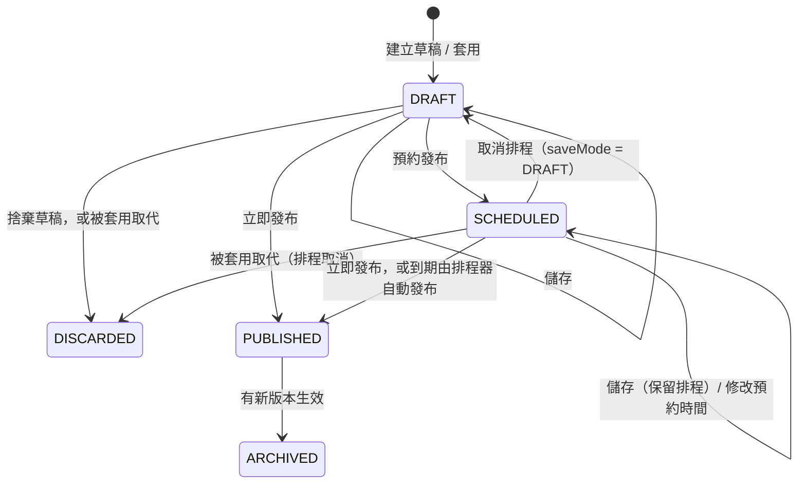

# 04 MongoDB Schema

> 版本：v1.4（POC）・2026-11-06（稽核紀錄保存期限改為 5 年，對齊平台稽核日誌，待法遵確認；TTL index 改名為 `IX_ICRM_AI_AUDIT_TTL`、`IX_ICRM_AI_EVAL_TTL`；v1.3 2026-11-03：Prompt 管理 review 修正：2.1 `basedOnVersion`、`scheduledAt`、`content` 單位；2.3 validator 加入類型與 key 一致性規則；2.4 建立草稿記錄來源、立即發布清空預約時間、排程到期先驗證；2.5 名稱與修改說明每次儲存都檢查；2.7 多機首次啟動的限制，見 [Prompt 管理 review 修正設計](../superpowers/specs/2026-11-02-prompt-admin-review-fixes-design.md)；v1.2 2026-10-30：2.5 顧客編號禁止規則改為 `certNo` 格式、補未納入的越權指令樣式；v1.1 2026-10-29 為 audit 移除顧客編號欄位與索引 `IX_ICRM_AI_AUDIT_3`；seed 改為 7 個問題分類；範例帳號改為員工帳號；見 [customer360 內容重寫設計](../superpowers/specs/2026-10-28-customer360-content-rewrite-design.md)）

## 1. Collection 總覽

| Collection | 用途 | 資料量預估 | Sharding |
|---|---|---|---|
| `COLL_ICRM_AI_ASSISTANT_CONFIG` | System Prompt 與 System Instructions 的所有版本 | 數十到數百筆 | 不需要 |
| `COLL_ICRM_AI_ASSISTANT_AUDIT` | 稽核紀錄（提問、回答、工具呼叫） | 每次提問 1 筆，保留 5 年（1,825 天） | POC 不 shard；全行開放後很可能需要（見第 5 節，待確認） |
| `COLL_ICRM_AI_ASSISTANT_EVAL_RUN` | Prompt 評測紀錄（每次評測 1 筆，題目結果嵌入） | 每次評測 1 筆（約數百 KB），保留 180 天 | 不需要（見第 5.4 節） |

> collection 前綴採 SP 計畫指定的 `COLL_ICRM_`；index 名稱比照使用 `UK_ICRM_`、`IX_ICRM_`。
> 對話內容**不保存供使用者回看**（需求 3-1），所以沒有對話 collection；稽核 collection 只保存每次提問與最終回答，供稽核使用（需求 3-4）。

---

## 2. `COLL_ICRM_AI_ASSISTANT_CONFIG`

### 2.1 Document

每個版本是一份獨立的 document，不把版本歷程嵌在陣列裡。

| 欄位 | 型別 | 必填 | 說明 |
|---|---|---|---|
| `_id` | ObjectId | ✓ | |
| `configKey` | string | ✓ | `^(system\|instruction)\.[a-z0-9-]{1,50}$` |
| `configType` | string | ✓ | `SYSTEM_PROMPT`（只有一份 `system.main`）或 `SYSTEM_INSTRUCTION`（每份一個問題分類） |
| `name` | string | ✓ | 顯示名稱，1–50 字 |
| `content` | string | ✓ | Markdown 內容。Mongo validator 以字元計算，最多 65,536 字元；API 與發布前驗證以 UTF-8 bytes 計算，最多 65,536 bytes，這是實際生效的限制。任何字元編碼成 UTF-8 至少 1 byte，所以通過 API 的內容一定通過 Mongo；validator 只是防止繞過 API 的寫入 |
| `status` | string | ✓ | `DRAFT`（草稿）、`SCHEDULED`（已排程）、`PUBLISHED`（已發布）、`ARCHIVED`（已封存：曾上線、後被新版取代）、`DISCARDED`（已捨棄：未上線就被捨棄或被套用取代） |
| `version` | int | ✓ | 內部流水號，同一個 `configKey` 從 1 開始遞增；只用於 API 路徑、排序與唯一索引（需求 3-5），**畫面不顯示** |
| `basedOnVersion` | int \| null | | 建立草稿或套用時的來源版本流水號；新增設定的 v1 草稿與初始資料為 null |
| `changeNote` | string \| null | | 修改說明，最多 200 字 |
| `createdBy` | string | ✓ | |
| `createdAt` | date | ✓ | |
| `updatedBy` | string | ✓ | 最後一次變更這份版本的人：儲存、套用、預約、發布會更新；**封存不更新**（見 2.4） |
| `updatedAt` | date | ✓ | 最後一次變更的時間；已發布 / 已封存版本即為生效時間，畫面以它辨識版本 |
| `scheduledAt` | date \| null | | 預約發布時間。`SCHEDULED` 必填；退回草稿或立即發布時清空；排程器到期發布後保留，作為「原預約時間」紀錄 |
| `docVersion` | long | ✓ | Spring Data `@Version` 樂觀鎖，每次更新加 1 |

> 後台管理人員和 IT 管理人員都可以發布，不另設審核關卡；不另設 `publishedBy`、`publishedAt`，發布資訊記在 `updatedBy`、`updatedAt`，以版本歷程追溯每次變更。

> `version` 和 `docVersion` 用途不同：`version` 是 v1、v2、v3 這種業務版本；`docVersion` 是防止同一份 document 被同時修改的樂觀鎖。

範例：

```json
{
  "_id": { "$oid": "6713a1f0c2a4b5e6f7a8b9c0" },
  "configKey": "instruction.market-brief",
  "configType": "SYSTEM_INSTRUCTION",
  "name": "市場快訊",
  "content": "## 適用問題\n使用者詢問大盤、指數、個股行情或公司重大訊息……\n\n## 回答套版\n……\n\n## 範例問題\n- 今天大盤收盤如何？\n\n## 注意事項\n……",
  "status": "PUBLISHED",
  "version": 2,
  "basedOnVersion": null,
  "changeNote": "補充資料時間的說明",
  "createdBy": "EEE22222",
  "createdAt": { "$date": "2026-10-19T02:00:00Z" },
  "updatedBy": "EEE11111",
  "updatedAt": { "$date": "2026-10-24T01:00:00Z" },
  "scheduledAt": { "$date": "2026-10-24T01:00:00Z" },
  "docVersion": 4
}
```

> 這個範例是 `EEE11111` 預約在台北時間 10/24 09:00 發布、由系統到期自動發布的版本：`updatedBy` 記預約的人，`updatedAt` 是實際生效時間。

### 2.2 Index

| 名稱 | 欄位 | 選項 | 用途 |
|---|---|---|---|
| `UK_ICRM_AI_CFG_1` | `{ configKey: 1, version: 1 }` | unique | 需求指定；同一個 key 的內部流水號不重複 |
| `UK_ICRM_AI_CFG_2` | `{ configKey: 1 }` | unique，partial：`{ status: "PUBLISHED" }` | 由資料庫保證同一個 key 只有一個已發布版本 |
| `UK_ICRM_AI_CFG_3` | `{ configKey: 1 }` | unique，partial：`{ status: "DRAFT" }` | 同時建立草稿時只有一份成功 |
| `IX_ICRM_AI_CFG_4` | `{ status: 1, configType: 1 }` | | 讀取所有已發布設定（組 prompt 時使用） |
| `IX_ICRM_AI_CFG_5` | `{ status: 1, scheduledAt: 1 }` | partial：`{ status: "SCHEDULED" }` | 排程器查詢到期的版本 |

> **一個 key 同時只有一份「編輯中版本」（`DRAFT` 或 `SCHEDULED`）**。`SCHEDULED` 只能由既有的 `DRAFT` 原地轉換而來，所以「建立草稿」時檢查兩種狀態都不存在，再加上 `UK_ICRM_AI_CFG_3` 擋住同時建立，就能保證這條規則。

### 2.3 JSON Schema Validation

```javascript
db.createCollection("COLL_ICRM_AI_ASSISTANT_CONFIG", {
  validationLevel: "strict",
  validationAction: "error",
  validator: {
    $jsonSchema: {
      bsonType: "object",
      required: ["configKey", "configType", "name", "content", "status", "version",
                 "createdBy", "createdAt", "updatedBy", "updatedAt", "docVersion"],
      properties: {
        configKey:      { bsonType: "string", pattern: "^(system|instruction)\\.[a-z0-9-]{1,50}$" },
        configType:     { enum: ["SYSTEM_PROMPT", "SYSTEM_INSTRUCTION"] },
        name:           { bsonType: "string", minLength: 1, maxLength: 50 },
        content:        { bsonType: "string", maxLength: 65536 },
        status:         { enum: ["DRAFT", "SCHEDULED", "PUBLISHED", "ARCHIVED", "DISCARDED"] },
        version:        { bsonType: "int", minimum: 1 },
        basedOnVersion: { bsonType: ["int", "null"], minimum: 1 },
        changeNote:     { bsonType: ["string", "null"], maxLength: 200 },
        createdBy:      { bsonType: "string" },
        createdAt:      { bsonType: "date" },
        updatedBy:      { bsonType: "string" },
        updatedAt:      { bsonType: "date" },
        scheduledAt:    { bsonType: ["date", "null"] },
        docVersion:     { bsonType: "long" }
      }
    },
    $and: [
      // SCHEDULED 必須有預約時間
      { $or: [ { status: { $ne: "SCHEDULED" } }, { scheduledAt: { $type: "date" } } ] },
      // SYSTEM_PROMPT 的 key 只能是 system.main
      { $or: [ { configType: { $ne: "SYSTEM_PROMPT" } }, { configKey: "system.main" } ] },
      // SYSTEM_INSTRUCTION 的 key 必須以 instruction. 開頭
      { $or: [ { configType: { $ne: "SYSTEM_INSTRUCTION" } }, { configKey: { $regex: "^instruction\\." } } ] }
    ]
  }
});
```

> validator 可以同時使用 `$jsonSchema` 和查詢運算子；上面的 `$and` 以三條 `$or` 規則確保 `SCHEDULED` 一定有 `scheduledAt`，且 `configType` 與 `configKey` 一致。`ConfigCommandUseCase`（與 domain 的 `AssistantConfig`）也會在寫入前檢查。實際內容見 `backend/src/main/resources/mongo/config-validator.json`。
>
> `maxLength` 以字元計算，上限 65,536 字元；API 以 UTF-8 bytes 計算（見 2.1 `content`），所以通過 API 的內容一定通過這裡。`validationLevel: strict` 會讓既有文件在下次更新時也受檢查；初始資料都符合規則，不需要資料遷移。

### 2.4 版本策略



- **已封存（`ARCHIVED`）**：曾經上線、後來被新版本取代。`updatedAt` 是它當初的生效時間。
- **已捨棄（`DISCARDED`）**：從未上線就被放棄，包括「捨棄草稿」與「被套用取代的草稿或排程」。內容完整保留，`updatedAt` / `updatedBy` 是捨棄的時間與操作者，原作者見 `createdBy`。
- **沒有任何操作會刪除 document**，所有內容（含未上線的）都留在版本歷程中。

套用歷史版本（`PUBLISHED`、`ARCHIVED` 或 `DISCARDED`）時，**一律新增一份 `DRAFT`**；若已有編輯中版本（`DRAFT` 或 `SCHEDULED`），在同一個交易中把它改成 `DISCARDED`。

| 操作 | 對象 | 行為 | `updatedBy` / `updatedAt` |
|---|---|---|---|
| 建立草稿 | — | 已有 `DRAFT` 或 `SCHEDULED` → 409。否則複製目前已發布版本（沒有已發布版本時為最新版本）的 `name`、`content`，新增 `version = 最大值 + 1`、`status = DRAFT`，`basedOnVersion` 記錄來源版本 | 操作者 / 現在 |
| 儲存 | DRAFT | 更新內容，維持 `DRAFT`；`name`、`changeNote` 含禁止內容 → 422 | 操作者 / 現在 |
| 儲存 | SCHEDULED | 更新內容，**保留排程**；先執行發布前驗證（含 `name`、`changeNote`），不通過 → 422 | 操作者 / 現在（視為由此人重新確認排程） |
| 取消排程（`saveMode = DRAFT`） | DRAFT | 同「儲存」（畫面只在已排程時提供「取消排程」） | 操作者 / 現在 |
| 取消排程（`saveMode = DRAFT`） | SCHEDULED | 更新內容，`status = DRAFT`、清空 `scheduledAt`（取消排程） | 操作者 / 現在 |
| 立即發布 | DRAFT、SCHEDULED | 先驗證；在交易中把舊的 PUBLISHED 改成 ARCHIVED、編輯中版本改成 PUBLISHED，同時清空 `scheduledAt` | 新版：操作者 / 現在；**舊版：不改動** |
| 預約發布 | DRAFT、SCHEDULED | 先驗證；`status = SCHEDULED`、寫入 `scheduledAt`（已排程時即修改預約時間） | 操作者 / 現在 |
| 排程到期 | SCHEDULED | 排程器先重新驗證。通過：在交易中把舊的 PUBLISHED 改成 ARCHIVED、SCHEDULED 改成 PUBLISHED；`scheduledAt` 保留。不通過：退回 `DRAFT`（見下方排程器） | 新版：**維持預約者** / 實際生效時間；舊版：不改動 |
| 套用 | 來源：PUBLISHED、ARCHIVED、DISCARDED | 已有編輯中版本且未帶 `confirmOverwrite: true` → 409 `AI_CONFIG_OVERWRITE_PENDING`。否則在交易中：(1) 既有的編輯中版本改為 `DISCARDED`（`scheduledAt` 保留，作為「原預約時間」紀錄）；(2) 新增一份 `DRAFT`：`version = 最大值 + 1`，`name`、`content` 取自來源版本，`basedOnVersion = 來源版本`，`changeNote` 空。來源版本本身不變 | 新草稿：操作者 / 現在（`createdBy` 也是操作者）；被取代的版本：操作者 / 現在 |
| 捨棄草稿 | DRAFT | `status = DISCARDED`，內容保留，不刪除；`SCHEDULED` 需先取消排程才能捨棄 | 操作者 / 現在 |

所有寫入都以 `docVersion` 做條件更新；不一致 → 409 `AI_CONFIG_CONFLICT`。

**為什麼封存時不改動舊版的 `updatedBy` / `updatedAt`**

- 畫面以 `updatedAt` 辨識版本（不顯示版本號），已發布或已封存版本的 `updatedAt` 必須固定是它當初生效的時間。
- 舊版只會在另一個版本生效時被封存，沒有單獨的封存操作。所以封存的時間與造成封存的人，就是下一個版本的 `updatedAt` 與 `updatedBy`，從版本歷程即可推得，不需要另外記錄。

**預約時間規則**

- 至少 1 分鐘後、最多 90 天內，否則 400 `AI_INPUT_INVALID`。
- API 以 ISO 8601 含時區傳遞，資料庫存 UTC，管理頁以台北時間顯示。

**排程器（`ScheduledPublishJob`）**

- 每 30 秒查詢 `status = SCHEDULED` 且 `scheduledAt <= 現在` 的版本，逐筆在交易中發布，最多延遲約 30 秒。
- 以條件更新（`status` 仍為 `SCHEDULED` 且 `docVersion` 相符）確保多台機器同時執行時只會發布一次；失敗的一方直接略過。
- 每筆到期版本先做完整的發布前驗證（含 `name`、`changeNote`、`content`），因為驗證規則會變（例如 `allowed-url-hosts` 調整或新增禁止樣式），排程中儲存時的驗證只保證當下合格。
- 驗證不通過時，以條件更新（`_id` 相符、`status` 仍為 `SCHEDULED`、`docVersion` 相符）退回草稿：`status = DRAFT`、`scheduledAt = null`、`updatedBy = "system"`、`updatedAt = 現在`、`docVersion` 加 1。這是單一文件的更新，不需要交易；舊的已發布版本不動，快取不清除。條件更新沒有命中（已被改動或已被另一台機器處理）則略過。
- 退回成功時記 WARN log，只含 configKey、version 與未通過的規則代碼（例如 `FORBIDDEN_CONTENT`），不含內容或訊息文字。
- 發布成功後清除 prompt 快取。
- 發布失敗（例如交易衝突）會在下一輪重試，並記 WARN log（只含 configKey、version、錯誤類型）。

**套用時已有編輯中版本**

- 套用請求必須帶 `confirmOverwrite: true` 與目前編輯中版本的 `docVersion`，否則回 409 `AI_CONFIG_OVERWRITE_PENDING`，`details` 告知編輯中版本的狀態、`scheduledAt`、`updatedAt`、`docVersion`。
- 前端跳出確認視窗（文字見 02 §3.10），使用者確認後帶旗標重送。
- 套用後，原本的編輯中版本變成 `DISCARDED`（排程隨之取消，不會到期發布），內容仍可在版本歷程中比較或再套用回來。

**其他**

- 內部流水號 `version` 只增不減；沒有任何操作會刪除 document 或覆寫其他版本的內容，歷程完整可追溯。
- 交易需確保「同一個 key 最多一份 `DRAFT`」：套用時先把舊的編輯中版本改為 `DISCARDED`，再新增 `DRAFT`，兩步在同一個交易中完成。
- 交易需要 replica set：docker compose 以單節點 replica set（`rs0`）啟動。
- 同時有兩人發布時，partial unique index `UK_ICRM_AI_CFG_2` 確保不會出現兩個 PUBLISHED，後到的交易失敗並回傳 409。

### 2.5 發布前驗證

| 規則代碼 | 內容 |
|---|---|
| `NOT_EMPTY` | 去除空白後不可為空 |
| `MAX_SIZE` | UTF-8 編碼後最多 65,536 bytes |
| `REQUIRED_SECTION` | `SYSTEM_PROMPT` 不要求任何章節（平台安全規則由程式碼的 `SafetyRules` 固定附加）；`SYSTEM_INSTRUCTION` 只要求 `## 適用問題`，且該章節（到下一個 `## ` 標題之間）至少有一行非空白文字，因為路由只看分類名稱與這一節 |
| `EXAMPLE_QUESTIONS` | `SYSTEM_INSTRUCTION` 的 `## 範例問題` 選填：可省略章節，有的話 0–5 個 `- ` 條列，每題最多 40 字；沒有範例問題的分類不顯示在快捷問題區，但仍參與路由 |
| `FORBIDDEN_CONTENT` | 不得包含下表任何樣式 |

禁止內容（regex，不分大小寫）：

| 類型 | 樣式範例 |
|---|---|
| API key / token | `sk-[A-Za-z0-9_-]{16,}`、`Bearer\s+[A-Za-z0-9._-]{16,}` |
| 密碼 | `(password\|passwd\|密碼)\s*[:：=]` |
| 網址 | `https?://` 之後的 host（只取主機名稱字元：英數字、`.`、`-`，遇到其他字元即停止，所以緊接在後的 `)`、`。` 等標點不算進 host；結尾的 `.` 忽略；轉小寫）不在白名單 `ai-assistant.config.allowed-url-hosts` 內；清單為空＝不允許任何網址。完全相等才放行，不含子網域；host 後面緊接 `@`（如 `https://docs.example.com@evil.com`）一律不允許 |
| IP | `\b\d{1,3}(\.\d{1,3}){3}\b`，獨立一項，一律擋，不受白名單影響（`http://10.1.2.3` 也擋） |
| 身分證號 | `\b[A-Z][12]\d{8}\b` |
| 手機號碼 | `\b09\d{2}-?\d{3}-?\d{3}\b` |
| 顧客編號 | 與 `PiiRedactor` 規則 7 同一組樣式（`PiiRedactor.CERT_NO_REGEX`）：`[A-Z][12]\d{8}`、`[A-Z]{3}\d{6}`、`&[A-Z]\d{8}`，前後不得緊接英數字或 `&`（見 [03-tool-catalog.md](03-tool-catalog.md) 1.6；後兩種為推定，整合時換成平台實際格式） |

- 白名單與 tool call 的 `market.twse.allowed-hosts` 各自獨立：後者管後端程式可連線的對象，前者管 prompt 裡可以寫的連結。修改清單需改設定並重新啟動。
- 名稱（`name`）與修改說明（`changeNote`）也套用同一組禁止內容規則，且**每次儲存都檢查**（任何狀態、任何 `saveMode`），不通過回 422 `AI_CONFIG_VALIDATION_FAILED`；`content` 維持只在發布前（及 `SCHEDULED` 以 `KEEP_STATUS` 儲存時）檢查。`changeNote` 為 null 或空字串時略過。錯誤排列順序：內容、名稱、修改說明。
- **未納入的樣式**：需求 3-5 的「可繞過權限的指令」（例如「忽略以上規則」）目前不在禁止清單：這類自然語言樣式誤判率高，且安全規則寫死在程式碼並放在 prompt 最後（[01-architecture.md](01-architecture.md) 第 4 節），要求模型忽略使用者與資料中的指令。列為待辦，若之後需要再以 regex 加入（questions-for-manager M24）。
- 錯誤訊息格式（`rule` 為 `FORBIDDEN_CONTENT`）：`第 {n} 行疑似包含{類型}，請移除`，類型直接接在「疑似包含」後面，例如 `第 12 行疑似包含未允許的網址，請移除`、`第 12 行疑似包含IP 位址，請移除`、`第 12 行疑似包含API key 或 token，請移除`。
- 名稱與修改說明的錯誤訊息（`rule` 為 `FORBIDDEN_CONTENT`）：`名稱疑似包含{類型}，請移除`、`修改說明疑似包含{類型}，請移除`，例如 `修改說明疑似包含手機號碼，請移除`。
- 其他驗證訊息：`缺少必要章節「## 適用問題」`、`「## 適用問題」不可空白`、`「範例問題」最多 5 題，目前有 {n} 題`、`「範例問題」每題最多 40 字`。

### 2.6 讀取與快取

- 組 prompt 與快捷問題（`/suggestions`）時讀取所有 `status = PUBLISHED` 的設定，放在記憶體快取。
- `## 範例問題` 在發布時解析並快取，不在每次請求時重新解析。
- 發布或排程到期成功後清除快取；為了多台機器的情況，快取另設 60 秒 TTL。（套用只產生草稿，不影響已發布內容，不需清除快取）

### 2.7 初始資料

第一次啟動時，若 collection 為空，從 `classpath:seed/*.md` 匯入以下設定並直接發布 v1：

| configKey | configType | 名稱 |
|---|---|---|
| `system.main` | SYSTEM_PROMPT | 主要系統提示 |
| `instruction.customer-overview` | SYSTEM_INSTRUCTION | 顧客概況 |
| `instruction.asset-liability` | SYSTEM_INSTRUCTION | 資產負債 |
| `instruction.member-rank` | SYSTEM_INSTRUCTION | 會員等級 |
| `instruction.opportunity` | SYSTEM_INSTRUCTION | 商品機會 |
| `instruction.engagement` | SYSTEM_INSTRUCTION | 往來與通路 |
| `instruction.contact-prep` | SYSTEM_INSTRUCTION | 聯繫準備 |
| `instruction.market-brief` | SYSTEM_INSTRUCTION | 市場快訊 |

- 完整內容見 [07-prompt-examples.md](07-prompt-examples.md)（內容與 `seed/*.md` 一致）。`seed/manifest.json` 的順序是匯入順序；快捷按鈕與管理頁清單一律依 `configKey` 排序。
- `SeedLoader` 在設定 collection 已有資料時**跳過**，所以舊資料庫不會載入新 seed；改版後要先清空 MongoDB（見 [setup.md](../setup.md)）。
- 初始資料的 `createdBy`、`updatedBy` 為 `system`。
- 多台機器同時首次啟動時，初始資料匯入會撞唯一索引；POC 不處理，正式環境改用 migration。

### 2.8 資料生命週期

- 所有版本（含 `DISCARDED`）永久保留，不設 TTL：資料量小，而且版本歷程本身就是稽核依據。
- 如果之後資料量變大，可以把超過一年的 `ARCHIVED`、`DISCARDED` 版本搬到封存 collection（目前不實作）。

---

## 3. `COLL_ICRM_AI_ASSISTANT_AUDIT`

每次提問寫入一份 document，記錄使用者、提問、回答（含各段的引用標註），以及本次所有工具呼叫的執行結果與引用資訊。

### 3.1 Document

| 欄位 | 型別 | 說明 |
|---|---|---|
| `_id` | ObjectId | |
| `traceId` | string | 平台追蹤碼，對應一次提問；最長 64 字，超過截斷 |
| `userId` | string | |
| `roleKey` | string | 業務角色碼，例如 `RM`；供依角色統計 |
| `accessLevel` | string | `FULL` 或 `LIMITED` |
| `question` | string | 使用者本次提問，**存的是經過 `PiiRedactor` 處理後、實際送給 LLM 的版本**（最多 1000 字）；並再遮罩疑似憑證 |
| `answer` | string \| null | 模型最終回答（Markdown），**每個有引用的區塊後加 ` [n]` 標註**（多個引用並列，如 ` [1][2]`；`n` 為引用編號，對應 `toolCalls[].citationId`），可對照每段的依據；超過 8000 字截斷並設 `answerTruncated`；失敗時為 null |
| `answerTruncated` | bool | |
| `outcome` | string | `ANSWERED`、`FAILED` |
| `errorCode` | string \| null | 對話層級錯誤碼，例如 `AI_LLM_TIMEOUT`（見 05 第 2.2 節） |
| `toolCalls` | array | 本次工具呼叫，依呼叫順序；最多 5 筆（等於單次提問的 tool call 上限），未呼叫工具時為空陣列 |
| `toolCalls[].toolName` | string | |
| `toolCalls[].status` | string | `SUCCESS`、`ERROR`、`DENIED`、`TIMEOUT` |
| `toolCalls[].errorCode` | string \| null | 工具錯誤碼 |
| `toolCalls[].durationMs` | int | |
| `toolCalls[].citationId` | int \| null | 對應回答中的引用編號（1 起算）；沒有配發引用編號（呼叫失敗、無權限、逾時，或整題回答失敗（FAILED））時為 null |
| `toolCalls[].target` | string \| null | 工具宣告的非敏感查詢對象（例如「台積電 2330」），經 `PiiRedactor` 處理後最多 100 字；顧客工具一律為 null |
| `toolCalls[].dataTime` | string \| null | 資料日期（例如收盤日），最多 32 字 |
| `toolCalls[].resultCount` | int \| null | 結果筆數 |
| `toolCalls[].resultHash` | string \| null | 送給模型的去識別化結果（整段 payload）的 SHA-256，64 位十六進位 |
| `toolCalls[].result` | object \| null | 送給模型的 `data`；只有 `ai-assistant.audit.store-tool-results: true` 時才寫入，預設不寫入（欄位不存在） |
| `unverifiedNumbers` | string[] | 回答中在本次工具結果裡找不到依據的數字，去重，最多 20 個、每個最多 32 字 |
| `durationMs` | int | 整次提問的處理時間 |
| `modelCalls` | int | 本次呼叫 GPT 的次數（選填；舊紀錄沒有此欄位） |
| `inputTokens` | int | 各回合輸入 token 合計（選填） |
| `outputTokens` | int | 各回合輸出 token 合計（選填） |
| `totalTokens` | int | 各回合總 token 合計，供應商回報的值，可能略大於前兩者相加（選填）；**失敗的提問也記錄**，失敗前已花費的 token 仍算成本 |
| `promptVersions` | array | `[{ configKey, version }]`，本次組裝 system message **實際載入**的已發布版本（`system.main` 加上路由選出的 0 或 1 個問題分類；路由失敗時為全部），依 `configKey` 排序，與 system message 出自同一份快照；最多 100 筆，超過時截斷並記 WARN log（只含 `traceId` 與筆數）。用陣列是因為 `system.main` 含 `.`，不適合當欄位名稱 |
| `routeSource` | string \| null | 問題分類的決定方式：`ROUTER`（路由）、`CHIP`（快捷按鈕）、`FALLBACK`（路由失敗，載入全部分類）；選填，舊紀錄沒有此欄位，路由前就失敗的提問為 null。回饋統計用它判斷問題分類是否確定被使用（見 02 3.11） |
| `instructionKey` | string \| null | 實際載入的問題分類 `configKey`；路由為 `none` 與 `FALLBACK` 時為 null；選填，最多 64 字 |
| `summaryIn` | bool | 本次請求是否帶了摘要（選填；舊紀錄沒有此欄位） |
| `summaryStatus` | string \| null | `SUMMARIZED`、`FAILED`；`null` 表示沒有觸發摘要（歷史沒有超出保留範圍）。選填 |
| `summarizedMessages` | int | 超出保留範圍、交給摘要的訊息則數；沒有觸發時為 0。選填 |
| `summaryTokens` | int | 摘要呼叫的 total token，已含在 `totalTokens` 內；沒有呼叫時為 0。選填 |
| `modelName` | string \| null | 回答回合中最後一次由供應商回報的模型名稱（OpenAI 回應的 `model`；有些模型回傳帶日期的版本，`gpt-6-luna` 目前回傳 `gpt-6-luna`，與設定值相同）；沒有回答回合回報時（例如路由前就失敗）改記設定的 `ai-assistant.llm.model-name`。路由與摘要呼叫不列入。選填，舊紀錄沒有此欄位，最多 64 字 |
| `feedback` | string \| null | `UP`、`DOWN`；使用者回饋（`PUT /chat/{traceId}/feedback`，見 02 2.3）。寫入稽核時為 null |
| `feedbackAt` | date \| null | 最後一次變更回饋（含取消）的時間；寫入稽核時為 null |
| `createdAt` | date | |

**不記錄**：工具參數（只記錄工具自行宣告的非敏感查詢對象 `target`）、先前的對話歷史、摘要本文（只記上述四個摘要欄位的數字與狀態）、API key。工具結果只在 `ai-assistant.audit.store-tool-results: true` 時記錄，預設為 `false`，開啟前需 M36 法遵同意；平時只留 `resultHash` 供事後核對。

處理規則：

- `question` 存去識別化後的版本，再套用 2.5 節「API key / token」「密碼」樣式，命中的片段以 `[REDACTED]` 取代。
- `answer` 回傳前已經過 `PiiRedactor` 再檢查一次；稽核存的是同一份內容加上引用標註。`target` 同樣經過 `PiiRedactor`（再把「本顧客」代稱換成文字）才寫入。
- `unverifiedNumbers` 是後端核對的結果，只寫入稽核、不影響回答；模型自行換算的數字（例如「約占 3 成」）也會被記入。
- 稽核**不存顧客編號（`certNo`）**：顧客編號是身分證字號，`question` 與 `answer` 本來就是去識別化後的文字（本顧客的 `certNo` 已換成【本顧客】）。因此稽核紀錄只能追溯「誰在什麼時候問了什麼」，無法反查是哪位顧客；`PiiRedactor` 也會把其他顧客的 `certNo` 換成【其他顧客】。
- 提問與回答**只寫入這個 collection**，不寫入應用程式 log（見 05 第 5 節）。
- 使用者在前端按「取消」時，後端照常完成並寫入，`outcome` 依實際結果記錄。
- 回饋只更新 `{ traceId, userId: 目前使用者, outcome: "ANSWERED" }` 符合的紀錄（`traceId` 可能由呼叫端帶入而重複，所以一定同時比對 `userId`）；同一人有兩筆相同 `traceId` 時更新 `createdAt` 最新的一筆。上述新欄位選填，舊紀錄不補寫仍合法，也仍可被寫入回饋。
- 一般使用者看不到這些欄位，對話 API 的回應不變。
- POC 不提供查詢稽核紀錄的 API，需要時直接查 MongoDB（回饋的版本統計除外，見 02 3.11）。

範例：

```json
{
  "traceId": "463ac35c9f6413ad48485a3953bb6124",
  "userId": "ICRM00028",
  "roleKey": "RM",
  "accessLevel": "FULL",
  "question": "【本顧客】最近有什麼提醒？幫我準備下次聯繫重點",
  "answer": "### 待處理提醒\n\n- 定存 3,000,000 元將於 2026/11/15 到期…… [1]",
  "answerTruncated": false,
  "outcome": "ANSWERED",
  "errorCode": null,
  "toolCalls": [
    { "toolName": "getRealTimeCustomer", "status": "SUCCESS", "errorCode": null, "durationMs": 12,
      "citationId": 1, "target": null, "dataTime": null, "resultCount": 3,
      "resultHash": "9f2c…（SHA-256，共 64 字元）" },
    { "toolName": "getCustomer", "status": "SUCCESS", "errorCode": null, "durationMs": 9,
      "citationId": 2, "target": null, "dataTime": null, "resultCount": 1,
      "resultHash": "4be1…（SHA-256，共 64 字元）" }
  ],
  "unverifiedNumbers": [],
  "modelCalls": 2,
  "inputTokens": 5210,
  "outputTokens": 480,
  "totalTokens": 5690,
  "promptVersions": [
    { "configKey": "instruction.contact-prep", "version": 2 },
    { "configKey": "system.main", "version": 1 }
  ],
  "routeSource": "ROUTER",
  "instructionKey": "instruction.contact-prep",
  "summaryIn": false,
  "summaryStatus": null,
  "summarizedMessages": 0,
  "summaryTokens": 0,
  "modelName": "gpt-6-luna",
  "feedback": "UP",
  "feedbackAt": { "$date": "2026-10-19T06:04:10Z" },
  "durationMs": 2840,
  "createdAt": { "$date": "2026-10-19T06:03:22Z" }
}
```

### 3.2 Index

| 名稱 | 欄位 | 選項 | 用途 |
|---|---|---|---|
| `IX_ICRM_AI_AUDIT_TTL` | `{ createdAt: 1 }` | TTL：`expireAfterSeconds: 157680000`（1,825 天，對齊平台 `COLL_COMMON_AUDIT_LOG` 的 5 年） | 自動刪除過期紀錄。既有資料庫的舊 index `IX_ICRM_AI_AUDIT_1` 由啟動初始化刪除後重建；期限由 `createdAt` 計算，既有紀錄也適用新期限 |
| `IX_ICRM_AI_AUDIT_2` | `{ userId: 1, createdAt: -1 }` | | 依使用者查詢 |
| `IX_ICRM_AI_AUDIT_4` | `{ traceId: 1 }` | | 回饋更新（以 `traceId` 找紀錄）。既有資料庫若留有同名的舊 index（鍵為 `requestId`），必須先刪除整個集合（`drop`，只刪文件不夠），否則後端啟動失敗 |
| `IX_ICRM_AI_AUDIT_5` | `{ "promptVersions.configKey": 1, "promptVersions.version": 1 }` | partial：`{ feedback: { $type: "string" } }` | 回饋統計；只收有回饋的紀錄，索引很小 |

### 3.3 JSON Schema Validation

```javascript
db.createCollection("COLL_ICRM_AI_ASSISTANT_AUDIT", {
  validator: {
    $jsonSchema: {
      bsonType: "object",
      required: ["traceId", "userId", "roleKey", "accessLevel", "question", "outcome", "toolCalls", "durationMs", "createdAt"],
      properties: {
        traceId:         { bsonType: "string", maxLength: 64 },
        userId:          { bsonType: "string", maxLength: 64 },
        roleKey:         { bsonType: "string", maxLength: 32 },
        accessLevel:     { enum: ["FULL", "LIMITED"] },
        question:        { bsonType: "string", maxLength: 1000 },
        answer:          { bsonType: ["string", "null"], maxLength: 8000 },
        answerTruncated: { bsonType: "bool" },
        outcome:         { enum: ["ANSWERED", "FAILED"] },
        errorCode:       { bsonType: ["string", "null"], maxLength: 64 },
        toolCalls: {
          bsonType: "array",
          maxItems: 5,
          items: {
            bsonType: "object",
            required: ["toolName", "status", "durationMs"],
            properties: {
              toolName:   { bsonType: "string", maxLength: 64 },
              status:     { enum: ["SUCCESS", "ERROR", "DENIED", "TIMEOUT"] },
              errorCode:  { bsonType: ["string", "null"], maxLength: 64 },
              durationMs: { bsonType: "int", minimum: 0 },
              citationId: { bsonType: ["int", "null"], minimum: 1 },
              target:     { bsonType: ["string", "null"], maxLength: 100 },
              dataTime:   { bsonType: ["string", "null"], maxLength: 32 },
              resultCount: { bsonType: ["int", "null"], minimum: 0 },
              resultHash: { bsonType: ["string", "null"], minLength: 64, maxLength: 64 },
              result:     { bsonType: ["object", "null"] }
            }
          }
        },
        unverifiedNumbers: { bsonType: "array", maxItems: 20, items: { bsonType: "string", maxLength: 32 } },
        // 以下 13 個欄位為選填，舊紀錄仍合法
        modelCalls:     { bsonType: "int", minimum: 0 },
        inputTokens:    { bsonType: "int", minimum: 0 },
        outputTokens:   { bsonType: "int", minimum: 0 },
        totalTokens:    { bsonType: "int", minimum: 0 },
        promptVersions: {
          bsonType: "array", maxItems: 100,
          items: {
            bsonType: "object", required: ["configKey", "version"],
            properties: {
              configKey: { bsonType: "string", maxLength: 64 },
              version:   { bsonType: "int", minimum: 1 }
            }
          }
        },
        routeSource:    { enum: ["ROUTER", "CHIP", "FALLBACK", null] },
        instructionKey: { bsonType: ["string", "null"], maxLength: 64 },
        summaryIn:          { bsonType: "bool" },
        summaryStatus:      { enum: ["SUMMARIZED", "FAILED", null] },
        summarizedMessages: { bsonType: "int", minimum: 0 },
        summaryTokens:      { bsonType: "int", minimum: 0 },
        modelName:          { bsonType: ["string", "null"], maxLength: 64 },
        feedback:   { enum: ["UP", "DOWN", null] },
        feedbackAt: { bsonType: ["date", "null"] },
        durationMs: { bsonType: "int", minimum: 0 },
        createdAt:  { bsonType: "date" }
      },
      additionalProperties: true
    }
  }
});
```

### 3.4 寫入失敗

稽核寫入失敗不影響回答，但會以 ERROR 等級記 log（只含 traceId 與錯誤類型）。

---

## 4. 建立方式

- **POC**：啟動時由 `MongoSchemaInitializer` 冪等地建立 collection、validator、index（已存在就跳過或更新 validator）。三個 collection 的 validator 在 `backend/src/main/resources/mongo/` 的 `config-validator.json`、`audit-validator.json`、`eval-run-validator.json`。
- **正式環境**：改用平台的 migration 機制或交給 DBA，並在規格審查時確認。

---

## 5. 容量估算與 sharding（待確認）

> 平台的 MongoDB 8.0 叢集使用 Hash Sharding。全行開放（理專、AO、業務）後，稽核紀錄很可能需要 shard。**POC 階段先不改動作法**：不 shard、程式不修改。以下是目前的估算和建議，待 [questions-for-manager.md](../questions-for-manager.md) S18、M4、M36 確認後再定案。

### 5.1 稽核紀錄的資料量估算

假設：10,000 人、每人每天 20 題（偏高的估計）→ 每天 20 萬筆。每筆以 2 KB 計（POC 實測平均 0.8 KB、最大 1.1 KB，正式環境回答可能較長）。

| 保存期限 | 筆數 | 資料量（含 index 約） | 是否需要 shard |
|---|---|---|---|
| 180 天 | 約 3,600 萬 | 約 80 GB | 不一定，單一 replica set 可處理 |
| 1 年 | 約 7,300 萬 | 約 160 GB | 不一定 |
| 5～7 年（目前 TTL 為 5 年） | 3.6～5 億 | 0.8～1 TB | 建議 shard |

- 寫入量平均每秒約 7 筆、尖峰數十筆，壓力在累積的資料量，不在寫入速度。
- 引用相關欄位（`citationId`、`target`、`resultHash` 等）讓每筆約增加 0.3～0.5 KB，不影響上面的估算。
- token、回饋與路由相關欄位（`modelCalls`、三個 token 欄位、`promptVersions`、`routeSource`、`instructionKey`、`feedback`、`feedbackAt`）每筆再增加約 0.2～0.4 KB（主要是 `promptVersions`），同樣不影響估算結論。新增的兩個 index 中，`IX_ICRM_AI_AUDIT_4` 每筆都有一個 entry；`IX_ICRM_AI_AUDIT_5` 是 partial，只收有回饋的紀錄，很小。
- 如果開啟 `store-tool-results` 保存工具查到的原始資料（預設不保存，見 3.1），每筆可能增加到 10～20 KB（`tool-result-max-bytes` 4 KB × 最多 5 次工具呼叫），資料量放大 5～10 倍。

### 5.2 各 collection 的建議

| Collection | 建議 | 原因 |
|---|---|---|
| `COLL_ICRM_AI_ASSISTANT_CONFIG` | 不 shard | 筆數取決於設定與版本數，和使用人數無關。它依賴 3 個以 `configKey` 開頭的 unique index（2.2）和 transaction（2.4）；shard 後 unique index 必須以 shard key 開頭，可能無法維持原本的防重複機制 |
| `COLL_ICRM_AI_ASSISTANT_EVAL_RUN` | 不 shard | 每次評測 1 筆，量很小（見 5.4）；`UK_ICRM_AI_EVAL_1` 是 unique index，shard 後必須以 shard key 開頭，無法維持「同時只有一個執行中」的保證 |
| `COLL_ICRM_AI_ASSISTANT_AUDIT` | 需要時以 `{ userId: "hashed" }` shard | 寫入平均分散；依使用者查詢只查一個 shard。依顧客查詢會查所有 shard，但只在調查時使用，可接受 |

稽核紀錄 shard key 的比較：

| Shard key | 優點 | 缺點 |
|---|---|---|
| `{ userId: "hashed" }`（建議） | 寫入分散；依使用者查詢只查一個 shard | 依顧客查詢要查所有 shard |
| `{ _id: "hashed" }` | 分散最平均，設定最簡單 | 依使用者、顧客查詢都要查所有 shard |
| `{ createdAt: 1 }` | — | 時間遞增，新資料全部寫進同一個 shard。不可使用 |

- 單一使用者的資料量很小（7 年約 5 萬筆、100 MB 左右），不會形成無法拆分的 jumbo chunk。
- 如果之後要在伺服器保存對話紀錄供使用者回看，該 collection 的資料量會比稽核紀錄大，而且幾乎都是「查自己的對話」，應從一開始就以 `{ userId: "hashed" }` 設計。

### 5.3 shard 時不需要改的地方

- 稽核紀錄只有新增（回饋只更新 `feedback`、`feedbackAt` 兩個欄位），沒有 unique index，現有的 5 個 index 和 JSON Schema Validation 都可以保留。回饋更新的查詢條件含 `userId`，若以 `{ userId: "hashed" }` shard，仍可定位到單一 shard。
- TTL index 在 sharded collection 上照常運作。
- 應用程式透過 mongos 連線，程式碼不需修改；`sh.shardCollection` 指令放在平台的 migration（見第 4 節）。

### 5.4 評測紀錄的資料量

- 每次評測 1 份 document：最多 40 題（見第 6 節）× 2 份回答，每份回答最多 8,000 字，單份最大約 1.3 MB，遠低於 16 MB 上限；一般情況（三十多題、回答 500～1,500 字）約數百 KB。
- 評測由管理者手動觸發、同時只有一個，即使每天多次，180 天內也只有數百筆，約數百 MB 以內，不需要 shard。
- `question`、`answer` 是去識別化後的內容，與稽核紀錄同級敏感，只有 `AI_CONFIG_READ` 可讀；評測使用的是資料集指定的假測試顧客（見 [platform-setup-requests.md](../platform-setup-requests.md)）。

---

## 6. `COLL_ICRM_AI_ASSISTANT_EVAL_RUN`

每次 Prompt 評測寫入一份 document，記錄評測的設定、快照的版本、進度與每題兩個版本的結果。題目結果嵌入陣列，是有界資料。

**題數上限 40**：程式常數 `EvalConfiguration.STORED_CASES_MAX`，validator 的 `cases` maxItems 與 `totalCases`／`completedCases` maximum 是同一個數字，由 `EvalRunValidatorLimitsTest` 確保兩邊一致；資料集超過上限時啟動失敗。調整上限時改常數、validator 與本段，其他文件只連結到這裡。

設計見 [prompt-evaluation-design](../superpowers/specs/2026-10-24-prompt-evaluation-design.md) 第 5.2 節。

### 6.1 Document

| 欄位 | 型別 | 說明 |
|---|---|---|
| `_id` | ObjectId | 即 `runId`（API 用 24 碼十六進位字串） |
| `configKey` | string | 評測的設定，最多 64 字 |
| `candidateVersion` | int | 編輯中版本的 `version`（只供前端比對，畫面不顯示） |
| `candidateDocVersion` | long | 快照當下編輯中版本的 `docVersion`；前端據此判斷「評測後內容已修改」 |
| `candidateUpdatedAt` | date | 快照當下編輯中版本的 `updatedAt`；畫面以它辨識版本 |
| `baselineVersions` | array | `[{ configKey, version }]`，已發布設定的快照，最多 100 筆 |
| `datasetHash` | string | 資料集檔案的 SHA-256（64 字元）；與目前載入的資料集不同時，API 的 `datasetChanged` 為 true |
| `status` | string | `RUNNING`、`COMPLETED`、`FAILED` |
| `errorCode` | string \| null | `FAILED` 時的原因：`AI_EVAL_TIMEOUT`、`AI_EVAL_INTERRUPTED`、`AI_INTERNAL_ERROR` |
| `triggeredBy` | string | 觸發的管理者 `userId` |
| `startedAt` | date | |
| `heartbeatAt` | date | 執行緒開始、每完成一題時更新；超過 `stale-after`（10 分鐘）視為中斷 |
| `finishedAt` | date \| null | |
| `totalCases` / `completedCases` | int | 進度，各 0–題數上限 |
| `summary` | object \| null | `COMPLETED` 時寫入：`{ baseline: Metrics, candidate: Metrics, judgeTokens }` |
| `cases` | array | 每題一筆，最多題數上限筆，依資料集順序 |
| `cases[].caseId`、`group`、`question`、`expectRefusal`、`expectCategory` | | 題目資訊（寫入當下的內容）。`expectCategory` 是 `expect.category`（`configKey` 或 `none`，未設定為 null，選填，最多 64 字）。`question` 是去識別化後送給模型的提問（已發布版本那次，其次編輯中版本那次，兩次都沒送到模型時才是資料集原題），最多 1000 字 |
| `cases[].baseline`、`cases[].candidate` | object | `CaseResult`，見下表 |
| `docVersion` | long | 樂觀鎖 |

`Metrics`：`{ correct, total, toolsOk, routeOk, routeCases, refusedExpected, expectedRefusals, refusedNormal, normalCases, avgTotalTokens, avgInputTokens, avgOutputTokens, avgDurationMs }`（存原始計數，比率由前端計算）。

`CaseResult`：

| 欄位 | 型別 | 說明 |
|---|---|---|
| `outcome` | string | `ANSWERED`、`FAILED` |
| `errorCode` | string \| null | |
| `answer` | string \| null | 最多 8,000 字 |
| `toolCalls` | array | `[{ toolName, status }]`，最多 10 筆；`toolName` 最多 64 字 |
| `modelCalls`、`inputTokens`、`outputTokens`、`totalTokens`、`durationMs` | int | |
| `unverifiedNumbers` | string[] | 最多 20 個，每個最多 32 字 |
| `toolsOk`、`numbersOk` | bool | |
| `routeOk` | bool \| null | 分類是否符合 `expect.category`；題目沒有預期分類為 null |
| `routeSource` | string \| null | `ROUTER`、`CHIP`、`FALLBACK`（評測只會是 `ROUTER` 或 `FALLBACK`） |
| `instructionKey` | string \| null | 實際載入的分類，最多 64 字；`none` 與 `FALLBACK` 為 null |
| `missingPhrases`、`forbiddenPhrases` | string[] | 未出現的必要字詞、出現的禁止字詞，各最多 10 個、每個最多 50 字 |
| `judge` | object \| null | `{ refused, rubric: [{ text, met }], comment, error, tokens }`；作答失敗時為 null；評審失敗時 `error` 為 `AI_EVAL_JUDGE_FAILED`、`refused` 與 `comment` 為 null、`rubric` 為 `[]` |
| `passed` | bool | 作答成功 ∧ 規則全部通過 ∧ 評審成功 ∧ `refused` 等於預期 ∧ 評分要點全部達成 |

範例（節錄，只列一題）：

```json
{
  "configKey": "instruction.contact-prep",
  "candidateVersion": 3,
  "candidateDocVersion": { "$numberLong": "5" },
  "candidateUpdatedAt": { "$date": "2026-10-24T06:58:03Z" },
  "baselineVersions": [
    { "configKey": "instruction.contact-prep", "version": 2 },
    { "configKey": "system.main", "version": 1 }
  ],
  "datasetHash": "3f9a…（SHA-256，共 64 字元）",
  "status": "COMPLETED",
  "errorCode": null,
  "triggeredBy": "EEE22222",
  "startedAt": { "$date": "2026-10-24T07:02:11Z" },
  "heartbeatAt": { "$date": "2026-10-24T07:07:39Z" },
  "finishedAt": { "$date": "2026-10-24T07:07:40Z" },
  "totalCases": 30,
  "completedCases": 30,
  "summary": { "baseline": { "correct": 14, "total": 30, "…": "…" }, "candidate": { "…": "…" }, "judgeTokens": 48200 },
  "cases": [
    {
      "caseId": "Q8-contact-prep", "group": "顧客經營", "expectRefusal": false,
      "expectCategory": "instruction.contact-prep",
      "question": "聯繫這位顧客前，有哪些提醒要處理？",
      "baseline": {
        "outcome": "ANSWERED", "errorCode": null, "answer": "### 待處理提醒……",
        "toolCalls": [ { "toolName": "getCustomer", "status": "SUCCESS" } ],
        "modelCalls": 2, "inputTokens": 7080, "outputTokens": 340, "totalTokens": 7420, "durationMs": 6200,
        "unverifiedNumbers": [], "toolsOk": true, "numbersOk": true,
        "routeOk": true, "routeSource": "ROUTER", "instructionKey": "instruction.contact-prep",
        "missingPhrases": [], "forbiddenPhrases": [],
        "judge": { "refused": false, "rubric": [ { "text": "列出近期互動的日期與管道", "met": true } ],
                   "comment": "無", "error": null, "tokens": 1500 },
        "passed": true
      },
      "candidate": { "…": "…" }
    }
  ],
  "docVersion": { "$numberLong": "17" }
}
```

### 6.2 Index

| 名稱 | 欄位 | 選項 | 用途 |
|---|---|---|---|
| `UK_ICRM_AI_EVAL_1` | `{ status: 1 }` | unique，partial：`{ status: "RUNNING" }` | 同時只有一個執行中的評測（多個後端實例也成立）；插入時撞到唯一索引即回 `AI_EVAL_RUNNING` |
| `IX_ICRM_AI_EVAL_1` | `{ configKey: 1, startedAt: -1 }` | | 各 key 最近的評測歷程 |
| `IX_ICRM_AI_EVAL_TTL` | `{ startedAt: 1 }` | TTL：`expireAfterSeconds: 15552000`（180 天） | 自動刪除。既有資料庫的舊 index `IX_ICRM_AI_EVAL_2` 由啟動初始化刪除後重建 |

### 6.3 JSON Schema Validation

`eval-run-validator.json`（`validationLevel: strict`、`validationAction: error`）：

- 頂層必填：`configKey`、`candidateVersion`、`candidateDocVersion`、`candidateUpdatedAt`、`baselineVersions`、`datasetHash`、`status`、`triggeredBy`、`startedAt`、`heartbeatAt`、`totalCases`、`completedCases`、`cases`、`docVersion`；`status` 為 enum；`datasetHash` 固定 64 字元；`totalCases`／`completedCases` 0–40；`cases` 最多 40 筆（題數上限）。
- `cases[]` 必填 `caseId`、`group`、`question`、`expectRefusal`、`baseline`、`candidate`；`baseline`／`candidate`（`CaseResult`）的每個子欄位（型別、長度、陣列上限、`judge` 與 `rubric` 的子欄位）和 `summary` 的 `Metrics` 每個計數欄位都在 validator 內強制，與 6.1 的上限一致。
- 路由新增的欄位（`Metrics.routeOk`、`Metrics.routeCases`、`cases[].expectCategory`、`CaseResult.routeOk`、`routeSource`、`instructionKey`）都是選填，舊的評測紀錄仍合法；`routeSource` 為 enum（含 null），`instructionKey`、`expectCategory` 最多 64 字。
- 寫入前 `CaseResult` 已先截斷到這些上限，所以不會因長度超限而寫入失敗。

### 6.4 寫入方式

- 開始評測：`insert`（`status: RUNNING`、`completedCases: 0`、`cases: []`、`docVersion: 0`）；撞到 `UK_ICRM_AI_EVAL_1` → 409 `AI_EVAL_RUNNING`。
- 之後**只有評測執行緒寫入**，且每次寫入的條件都是 `{ _id, docVersion, status: "RUNNING" }`、同時 `$inc: { docVersion: 1 }`：
  - 執行緒開始：`$set: { heartbeatAt }`
  - 每題完成：`$push: { cases }`、`$inc: { completedCases: 1 }`、`$set: { heartbeatAt }`
  - 結束：`$set: { status: "COMPLETED", summary, finishedAt }`，或 `$set: { status: "FAILED", errorCode, finishedAt }`
- 條件不成立（`docVersion` 已變或 `status` 不再是 `RUNNING`）代表紀錄已被標為中斷，執行緒隨即停止，不再寫入。
- **陳舊紀錄**：「開始評測」與「查詢目前評測」時，若 `RUNNING` 紀錄的 `heartbeatAt` 超過 `stale-after`（10 分鐘），先標為 `FAILED`（`AI_EVAL_INTERRUPTED`）再繼續。
- 以 `@Document` 類別（`EvalRunDocument`）搭配 MapStruct 的 `EvalRunDocumentMapper` 讀寫；一律存在的可為 null 欄位標 `@Field(write = Field.Write.ALWAYS)`，null 也明確寫入。全域以 `DefaultMongoTypeMapper(null)`（`MongoConfiguration`）不產生 `_class`。集合名稱集中在 `infrastructure/mongo/AiAssistantCollections`，`@Document` 引用該常數。
- 不提供刪除 API；紀錄由 TTL 在 180 天後刪除。
