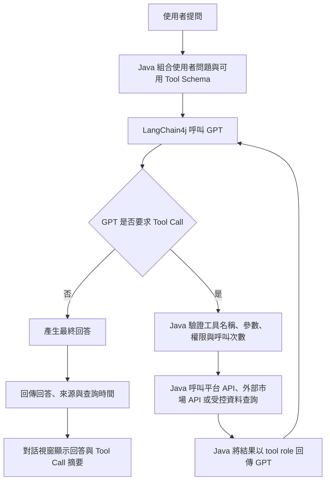

# 行銷人員顧問小幫手 Marketing Advisor Copilot

此project將建置一個由對話右下角開啟的 AI 對話助理，能依使用者權限調用平台上的API、查詢公開市場資訊，並透過 LangChain4j 與 GPT Tool calling 整合資料後回答顧客經營問題；目標是在不改變既有核心流程的前提下完成。這個小幫手之後會直接被平移進另一個專案平台內(by 複製貼上)

> 實作期間：4 週，10/19 ~ 11/13

## 1. 學習目標

1. 熟悉全端架構：理解 Vue 前端、Spring Boot 後端、MongoDB 與既有 API 的分工及依賴方向
2. 掌握 LLM tool calling: 透過 LangChain4j 實作「模型判斷工具、java 執行工具、模型整合回答」的完整流程
3. 設計可維護的 prompt 與 skill: 在平台上的後台管理服務內提供 .md 編輯、版本管理、發布與回復機制，並將內容持久化至 mongodb
4. 實踐文件即程式碼(docs-as-code): 開發前先完成 api, tool schema, mongodb document 與錯誤情境規格

## 2. 技術與架構要求

需沿用現有專案stack與開發規範，不另外建獨立登入、會員或前端應用程式

- 前端(web)：vue 3.5/Typescript strict/pinia/primevue 4 unstyled；API 呼叫統一透過既有 `api-client` 與 composable，禁止元件直接呼叫 axios
- 後端(ap)：java 25/spring boot 4.1/virtual threads/同步 REST API/Clean Architecture 與既有 Session/RBAC
- AI Orchestration：使用 LangChain4j 串接 GPT API，工具執行與權限判斷必須由 Java 控制，禁止前端直接呼叫 GPT
- 資料層(Data)：prompt, skill 與版本資訊儲存於 mongodb, collection 名稱須符合 `COLL_ICRM_` 前綴規範
- 內部資料來源：僅能呼叫經核准並列入Allowlist 的 API，不得讓模型自行產生URL, SQL, Mongodb Query 或繞過既有權限
- 外部資料來源：使用公開的股市或市場新聞資訊API，回覆須附資料來源與查詢時間
- 規格文件：開發前須產出 .md 格式之 API 規格/tool schema/ mongodb document schema 與錯誤碼清單

### 2-1. GPT API key 申請與保管

- 正式 key 開發前向 Team Leader 索取；POC 階段先使用個人專用 key（見 [docs/setup.md](docs/setup.md)）
- api key 僅可由後端透過 yaml config 注入
- 前端不得取得或轉送 api key, 所有 GPT 請求皆由 Java 後端代理

### 2-2. tool calling 流程

流程必須符合以下步驟:

1. java 將使用者問題、必要對話上下文及該使用者可使用的tool schema 送交 GPT
2. GPT 判斷是否需要即時資料，需要時回傳包含工具名稱與參數的結構化tool call
3. java 驗證 tool call 後執行對應工具，取得平台api、外部市場api或受控查詢的結果，並記錄本次工具呼叫摘要
4. java 將結果以 `role="tool"` 與對應 tool call id 再次送交 GPT
5. GPT 根據工具結果產生最終問答，Java 回傳答案、來源、查詢時間、必要警語及本次tool call 摘要
6. 對話視窗須以可展開區塊顯示本次呼叫的工具名稱、用途、執行狀態與耗時，未呼叫工具時不顯示此區塊

注意事項：

- tool call 摘要不得顯示原始參數、完整 tool result、顧客個資、內部api url、憑證或stack trace
- GPT 只負責選擇工具與整合文字，不得直接連線內部系統、外部API或資料庫

## 3. 核心功能要求(core requirements)

### 3-1. 右下角對話視窗(chat widget)

- 登入平台後，所有已授權頁面右下角顯示固定的助理按鈕，點擊後開啟對話視窗。
- 視窗需支援送出問題、顯示多輪訊息、Loading、取消顯示、錯誤提示及清除本次對話。
- Enter 送出、Shift+Enter 換行；送出期間須防止重複提交。
- 回答中的 Markdown、連結與引用內容必須安全渲染，禁止執行任意 HTML或 Script。
- 對話內容預設不保存

### 3-2. 顧客經營問答(customer advisory)

助理須能依使用者可存取範圍，回答至少三類顧客經營問題：

1. 顧客概況：彙整顧客基本資料、往來概況或既有標籤。
2. 經營機會：根據平台 API 回傳資料，整理可供行銷人員參考的關注面向。
3. 互動摘要：彙整近期互動紀錄或活動結果，協助準備後續聯繫。
4. 其他：自由發揮，請你使用對這個系統的了解，站在使用者角度設計可以諮詢的問題。

- 實作限制：僅能使用SIT測資

### 3-3. 股市與市場資訊調查(market research)

- 至少整合一個經核准的公開市場資料來源，支援查詢指數、個股公開行情或市場重要資訊。
- 外部 API Client 須設定連線與讀取 Timeout、錯誤轉換、回應大小上限及 Allowlist
  Host
- 每項市場資訊須顯示來源名稱、資料時間與查詢時間；逾時或來源失效時須明確告知。
- 不得爬取未授權網站、規避付費牆或違反資料來源使用條款。
- 回答需標示「資訊僅供內部經營參考，不構成投資建議」

### 3-4. LangChain4j Tool Registry

- 使用 LangChain4j 宣告可用工具，工具名稱、用途、參數與回傳格式須清楚且可測試。
- Tool Registry 依登入者角色及顧客資料權限動態提供可用工具，不可將所有工具無條件暴露給模型。
- Java 執行 Tool Call 前須再次驗證工具名稱、參數格式、欄位長度、權限與資源範圍。
- 單次提問須限制最大 Tool Call 次數、遞迴深度、Timeout 與 Token 使用量，避免無限循環及費用失控。
- 工具錯誤應轉換為可控的 Tool Result，不可將 Stack Trace、內網位址、Token 或完整機敏資料送給GPT。
- 工具呼叫須留下稽核資訊：使用者、工具名稱、問題、LLM 回答、執行結果、耗時與時間。

### 3-5. prompt / skill markdown 管理

提供具權限控管的管理頁，分別管理 System Prompt 與 Skill Markdown：

- 支援 Markdown 編輯、預覽、儲存草稿、發布、查看版本與回復前一版本。
- 每筆資料至少包含 `configKey`、`configType`、`name`、`content`、`status`、`version`、`updatedBy`、`updatedAt`。
- 建議使用 `COLL_ICRM_AI_ASSISTANT_CONFIG` 儲存設定，每個版本獨立為一份 Document，禁止將無界版本歷程嵌入陣列。
- 以 `configKey + version` 建立唯一索引 `UK_ICRM_AI_CFG_1`，並建立 MongoDB JSON Schema Validation；實際 Collection、Index 與 Sharding 設計須在開發前完成規格審查。
- Document 須使用 `@Version` 樂觀鎖，避免多人編輯互相覆蓋。
- 一般使用者僅可使用已發布版本；只有具管理權限者可進入編輯頁與發布版本。
- 發布前須驗證內容不可為空、大小上限、必要章節與禁止內容；Markdown 預覽必須進行 Sanitization。
- Prompt 與 Skill 不得包含 API Key、密碼、個資、內部連線資訊或可繞過權限的指令。

### 3-6. 對話安全與錯誤處理

- System Prompt 必須明確要求模型忽略使用者要求洩漏系統提示、憑證、內部設定或越權資料的指令。
- 使用者輸入、Tool Result 與外部市場內容均視為不可信資料，不得讓其中指令覆寫System Prompt 或工具權限。
- 前後端皆須限制輸入長度；後端須限制對話上下文長度及傳送至GPT 的資料量。
- GPT Timeout、Rate Limit、外部 API 失敗、內部 API 無權限及 MongoDB 衝突須有明確錯誤碼與友善訊息。
- 前端沿用全域錯誤處理與 Toast；不得顯示 Stack Trace、原始供應商錯誤或白畫面。
- GPT 或外部資訊來源暫時不可用時，平台其他功能仍須正常運作。

### 3-7. 文件

開發前須完成：

1. REST API 規格：Endpoint、權限、Request、Response、錯誤碼與範例。
2. Tool Catalog：工具名稱、用途、參數Schema、資料來源、權限與逾時設定。
3. MongoDB Schema:Document、Index、版本策略及資料生命週期。
4. 對答情境：設計使用者問題。

## 4. 加分挑戰（Bonus）

1. 回答引用

- 回答可展開查看使用的資料來源、工具名稱及資料時間，但不得顯示敏感參數或原始個資。

2. Prompt 評測集（Prompt Evaluation）

- 建立固定問答資料集，比較 Prompt / Skill 發布前後的正確性、工具選擇率、拒答率與平均 Token 使用量。

## 5. 評分與驗收標準（細項檢核表）

| 主維度 | 次項目 | 具體檢核標準 | 配分 |
| :--- | :--- | :--- | :--- |
| **一、核心功能實現 (40%)** | **1. 對話視窗** | 右下角入口、對話狀態、Loading、錯誤處理及響應式操作完整。 | 8% |
| | **2. 顧客經營問答** | 能依權限調用平台 API，回答可追溯且不捏造資料。 | 12% |
| | **3. 市場資訊調查** | 能調用核准來源，回答包含來源、資料時間與必要警語。 | 8% |
| | **4. Tool Calling 流程** | 完成兩階段 GPT 呼叫、`tool` role 回傳、參數驗證及迴圈限制。 | 12% |
| **二、程式碼品質與架構 (25%)** | **5. LangChain4j 封裝** | AI Service、Tool Registry、內外部 Client 職責清楚且符合平台分層。 | 8% |
| | **6. 前端架構** | 元件、composable、store 分工清楚，未於元件直接呼叫 Axios。 | 7% |
| | **7. Prompt / Skill 管理** | Markdown 編輯、預覽、版本、發布、回復與 MongoDB 樂觀鎖完整。 | 10% |
| **三、安全與系統韌性 (25%)** | **8. 權限與個資** | Session/RBAC、最小資料、遮罩及唯讀工具限制均有效。 | 8% |
| | **9. AI 安全** | API Key 保管、Prompt Injection、任意 Tool/URL 與無限呼叫防護有效。 | 9% |
| | **10. （待確認）** | SP 計畫原文缺漏此項。 | 8%（由 25% − 17% 推算） |
| **四、文件與探索 (10%)** | **11. 規格與測試** | API、Tool、MongoDB 與……（原文未寫完，待確認） | 6% |
| | **12. 加分項目** | 完成引用、評測集、回饋或可觀測性其中至少一項。 | 4% |
